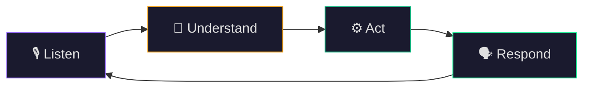
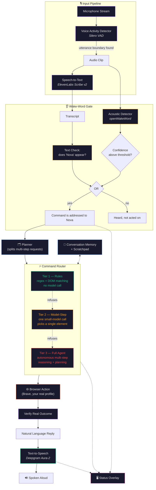
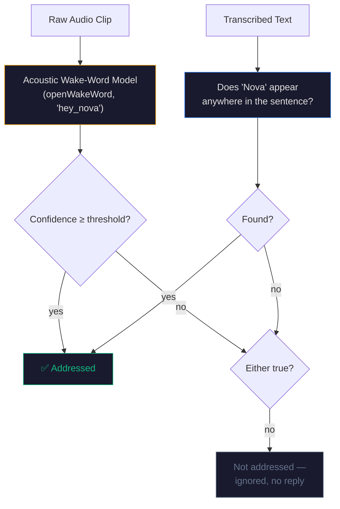
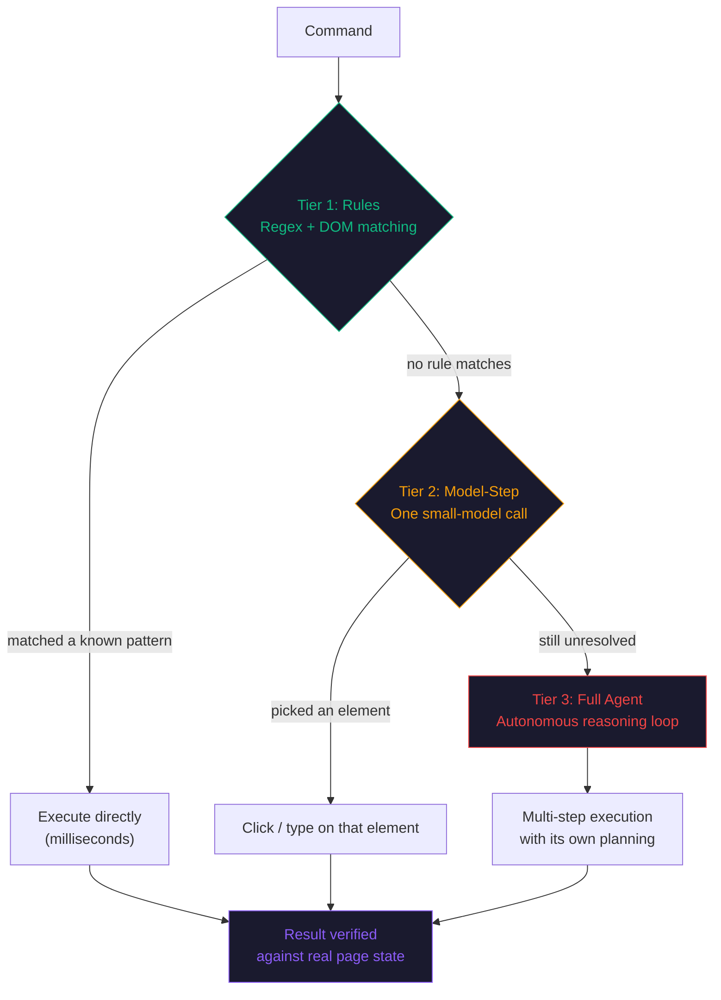
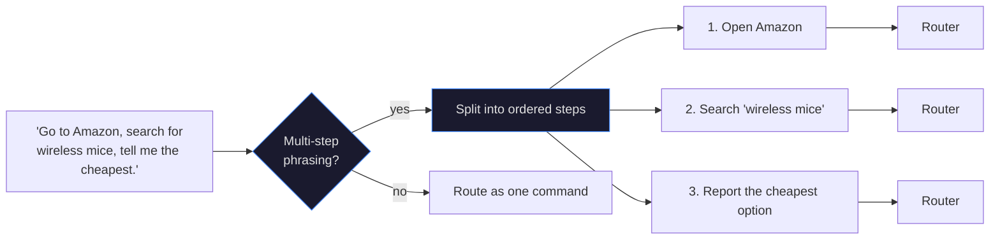
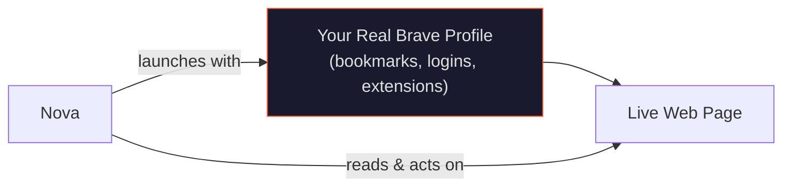

# Nova — Architecture

This document explains how Nova actually works, from the moment you speak to the moment the browser
acts and she replies. It starts simple and gets progressively more technical, so you can stop reading
whenever you have the depth you need.

## Table of Contents

- [1. The Big Picture](#1-the-big-picture)
- [2. Turning Sound Into Text](#2-turning-sound-into-text)
- [3. Deciding If She Was Addressed](#3-deciding-if-she-was-addressed)
- [4. The Three-Tier Command Router](#4-the-three-tier-command-router)
- [5. Handling Multi-Step Requests](#5-handling-multi-step-requests)
- [6. Memory and Context](#6-memory-and-context)
- [7. The Browser Layer](#7-the-browser-layer)
- [8. Turning Text Back Into Speech](#8-turning-text-back-into-speech)
- [9. The Status Overlay](#9-the-status-overlay)
- [10. Measuring It](#10-measuring-it)
- [11. Design Principles](#11-design-principles)

---

## 1. The Big Picture

At the simplest level, Nova is a loop:

Every one of those four words hides a real subsystem. "Listen" is voice-activity detection and
speech-to-text. "Understand" is wake-word detection, routing, and — for complex requests — planning.
"Act" is the browser layer. "Respond" is text-to-speech and the status overlay. The rest of this document
walks through each one.

The full picture, with every component named:

---

## 2. Turning Sound Into Text

### Voice Activity Detection (VAD)

Before any transcription happens, Nova needs to know *when you're actually talking* versus silence or
background noise. This is the job of the **VAD** — it watches small windows of raw audio (32ms frames)
and scores how likely each one is to contain speech.

Nova uses **Silero VAD**, a small neural model that runs locally and in real time. It's accurate enough
to tell the difference between a pause mid-sentence and the end of an utterance, which matters: cut the
clip too early and you lose the end of a sentence; wait too long and the assistant feels sluggish.

The VAD's output is a clean **start and end timestamp** for each utterance — the boundary the rest of the
pipeline treats as "this is one spoken command."

### Speech-to-Text (STT)

The captured audio clip is sent to a cloud transcription model — **ElevenLabs Scribe v2** — which returns
the text of what was said. A second provider, **Sarvam**, is available as an alternate transcription path,
chosen for its strength with Hindi-English (Hinglish) code-switching.

Why send audio to a cloud model rather than running speech-to-text locally? Accuracy. Cloud transcription
models are trained on vastly more data than anything practical to run on a laptop, and a voice assistant
lives or dies by how well it understands what you actually said.

---

## 3. Deciding If She Was Addressed

A microphone hears everything — including speech that isn't meant for the assistant at all. Nova needs
to separate "talking to Nova" from "talking near Nova," and it does this with **two independent
signals**, combined so that either one is sufficient:

**The acoustic detector** (openWakeWord, using the pretrained `hey_nova` model) listens to the raw sound
waveform directly — the same way a smart speaker reacts to its name. This works even if the transcription
service mishears the rest of the sentence, because it doesn't depend on transcription at all.

**The text check** looks at the already-transcribed sentence and matches "Nova" anywhere in it — not
just at the very start. This means *"Can you open GitHub, Nova?"* is recognized exactly as well as
*"Nova, open GitHub."*

Combining the two with **OR logic** means a command is accepted if *either* signal catches the name. Each
signal has a different failure mode — acoustic detection depends on raw audio characteristics, text
matching depends on transcription quality — so layering them gives a meaningfully more reliable gate than
either one alone.

---

## 4. The Three-Tier Command Router

This is the core design decision behind how Nova feels fast *and* capable at the same time. Instead of
sending every single command through a large reasoning agent (slow, and overkill for "open GitHub"),
every command is offered to three tiers **in increasing order of power**, and the first tier that can
confidently handle it wins.

### Tier 1 — Rules

A library of pattern-matching logic (`dom_fastpath.py`) recognizes common, well-defined requests:
navigating to a known site, pressing a named key ("hit F" → a literal keystroke, not a click), opening a
site's search box and typing a query, scrolling, going back. These resolve in a fraction of a second with
**no model call at all** — they're plain code.

### Tier 2 — Model-Step

Some commands need to identify *which* element on the page to interact with — "click the second result,"
"add this to the cart" — where the right target depends on what's actually rendered on the current page. A
single, focused call to a lightweight model looks at the page's structure and picks one element. This is
far cheaper and faster than a full autonomous agent, because it's asked to make exactly one decision rather
than plan a sequence of actions.

### Tier 3 — Full Agent

For requests that genuinely require multi-step reasoning — navigating through several pages, comparing
options, handling a flow where the next action depends on what the previous one revealed — Nova hands
the command to a full autonomous agent, built on the [browser-use](https://github.com/browser-use/browser-use)
framework. This tier can plan, act, observe the result, and adjust, the same way a person would work
through an unfamiliar website.

### Why this shape?

Most real commands are simple and repetitive — "open YouTube," "search for X," "scroll down." Routing
*every* command through a full reasoning agent would mean paying multi-second latency and real
compute cost for things that don't need it. The tiered design means the common case is instant, and the
expensive, powerful tier is reserved for commands that actually justify it. Every result — regardless of
which tier produced it — is checked against the real outcome (page content, URL, or the agent's own
report) before Nova considers the command successful.

---

## 5. Handling Multi-Step Requests

A single spoken sentence can describe several actions: *"Go to Amazon, search for wireless mice, and tell
me the cheapest one."* Before this reaches the router, the **planner** (`planner.py`) recognizes
multi-step phrasing and splits it into an ordered list of individual steps, each one handed to the router
in turn.

If a step in the middle of a plan doesn't go as expected, Nova can generate a one-shot replacement for
the remaining steps rather than abandoning the whole request — the plan adapts to what actually happened
on the page instead of blindly continuing a script that no longer matches reality.

---

## 6. Memory and Context

Conversations build on themselves. If you ask *"search for noise-cancelling headphones"* and then follow
up with *"which one is cheaper?"*, Nova needs to know what "which one" refers to.

`memory.py` keeps two things for the duration of a session:

- **Short-term conversation history** — the last several turns, so follow-up questions and corrections
  ("no, the other one") have something to resolve against.
- **A scratchpad of remembered facts** — specific details worth holding onto across turns (like the
  options just shown on screen), so comparison questions can be answered without re-reading the page.

This context is available to every tier of the router, not just the full agent — even a Tier 1 rule
match can benefit from knowing what was just discussed.

---

## 7. The Browser Layer

Nova controls **Brave**, launched with **your real browser profile** — the same bookmarks, saved
logins, and extensions you already have, rather than a disposable, empty automation browser. This matters
for genuine usefulness: a browsing assistant that can't see you're already logged into a site, or doesn't
have your saved passwords and bookmarks, can't actually do much on your behalf.

Underneath, this is powered by the `browser-use` library's control over a real Chromium-based browser, so
every action — clicking, typing, scrolling, navigating — happens exactly as it would if you did it
yourself, on the exact browser session you already use day to day.

---

## 8. Turning Text Back Into Speech

Once a command has been carried out (or a question answered), Nova composes a natural-language reply
and sends it to **Deepgram's Aura-2** text-to-speech model, using the "Phoebe" voice. Speech streams back
and starts playing before the entire reply has even finished generating, which keeps the conversation
feeling responsive rather than making you wait for a complete paragraph before anything plays.

Speech is **interruptible** — if you start talking while Nova is still speaking, playback stops
immediately so your next command is heard without having to wait her out.

---

## 9. The Status Overlay

A small, floating, always-on-top widget (`overlay.py`, built with Tkinter) shows at a glance what Nova
is currently doing — listening, thinking, speaking, or idle and waiting for her name — so you always know
whether she's ready for your next command. A single click opens a device picker to choose which
microphone and speakers she should use.

The overlay runs independently of the voice pipeline: the microphone loop runs in its own background
thread so the interface stays responsive and redraws smoothly regardless of what the rest of the system
is doing.

---

## 10. Measuring It

Rather than relying on a feel for "it seems to work," Nova ships with a real benchmark
(`nova/benchmark.py`): a battery of tasks spanning all three router tiers, each one checked against the
**actual resulting page state or reply text** — never just "the command ran without crashing." Each task
is run multiple times to surface a consistency signal, not just a single pass/fail. This turns "does it
work" into a number that can be tracked over time as the system evolves.

---

## 11. Design Principles

A few threads run through every decision described above:

- **Do the cheapest thing that works.** The three-tier router, and the rules layer within it, exist so that
  the majority of commands never touch a language model at all.
- **Verify, don't assume.** Every action — at every tier — is checked against real, observable outcomes
  (page state, returned text) rather than trusted just because it "ran."
- **Use the user's real environment.** The Brave launch deliberately uses your actual profile rather than
  a disposable sandbox, because a browsing assistant is only as useful as the context it has access to.
- **Make state visible.** The overlay exists so you're never left wondering whether Nova heard you,
  is thinking, or is about to speak.
- **Layer independent signals when reliability matters.** The acoustic-plus-text wake-word gate is the
  clearest example: two different kinds of evidence, combined, cover more ground than either alone.
