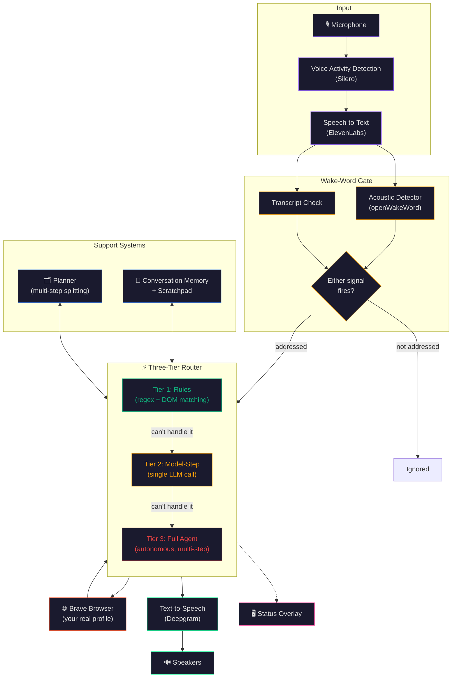
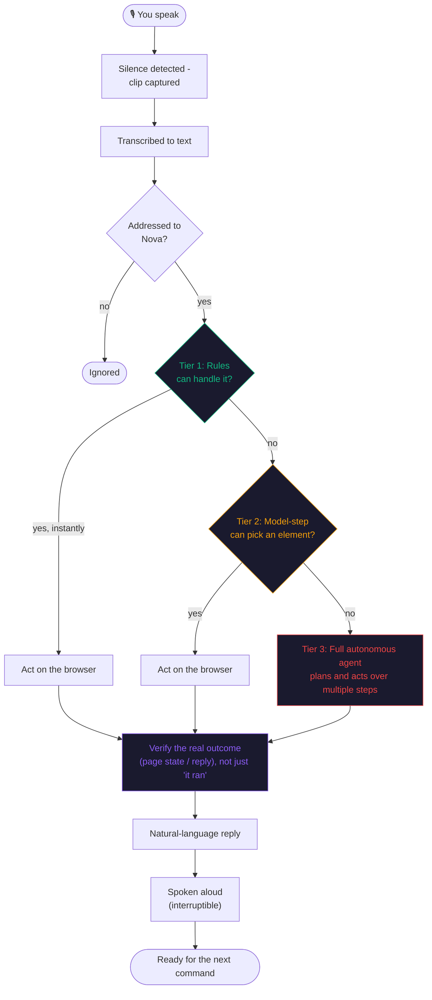

<div align="center">

<h1><b>🤖 Nova</b></h1>
<p><strong>A voice assistant that actually browses the web for you — on your real browser, with your real bookmarks and logins.</strong></p>

[](https://www.python.org/)
[](https://github.com/browser-use/browser-use)
[](https://elevenlabs.io/)
[](https://deepgram.com/)
[](https://github.com/dscripka/openWakeWord)
[](https://brave.com/)

</div>

---

## 📋 Table of Contents

- [Description](#-description)
- [Features](#-features)
- [Architecture](#-architecture)
- [Command Lifecycle](#-command-lifecycle)
- [Project Structure](#-project-structure)
- [Built With](#️-built-with)
- [Getting Started](#-getting-started)
- [Documentation](#-documentation)

---

## 📚 Description

**Nova** is a voice-driven assistant that controls a real web browser on your behalf. Say her name,
give her a command, and she listens, understands, and acts — searching, clicking, filling in forms,
reading pages back to you, and answering questions about what's on screen, all through natural spoken
conversation.

Unlike a typical browser-automation script, Nova runs on **your actual Brave browser**, with your real
profile — bookmarks, saved logins, and extensions all present, exactly as if you were sitting at the
keyboard yourself. And unlike a typical voice assistant, she's genuinely fast: most commands are handled
by lightweight rule-based logic in a fraction of a second, with a full reasoning agent kept in reserve for
anything that actually needs it.

---

## ✨ Features

- 🎙️ **Natural Voice Control** — speak naturally; no rigid command syntax required
- 👂 **Real Acoustic Wake Word** — say "Nova" and she reacts off the raw audio instantly, combined with a
  transcript-based check as a second signal for extra reliability
- ⚡ **Three-Tier Command Routing** — instant rule-based actions for common requests, a lightweight model
  for element-picking, and a full autonomous agent for anything genuinely complex — each command takes the
  fastest path that can actually handle it
- 🌐 **Your Real Browser, Not a Sandbox** — runs on your own Brave profile, so logins, bookmarks, and
  extensions are already there
- 🧠 **Conversation Memory** — remembers recent turns and facts within a session, so you can ask follow-up
  questions ("which one is cheaper?") without repeating context
- 🗂️ **Automatic Multi-Step Planning** — a single spoken request like "go to Amazon, search for monitors,
  and tell me the cheapest one" is automatically split into steps and executed in order
- 🔁 **Self-Correcting Plans** — if one step of a plan fails, Nova tries a one-shot replacement for the
  rest of the plan instead of simply giving up
- ⌨️ **Literal Keyboard Shortcuts** — "hit F" or "press M" sends a real keystroke (handy for fullscreen,
  mute, and other site shortcuts), not a guess at what to click
- 🗣️ **Natural, Interruptible Speech** — replies stream back as real speech, and you can talk over her at
  any point to interrupt and redirect
- 🖥️ **Live Status Overlay** — a small floating widget shows whether she's listening, thinking, or
  speaking, with one click to change your microphone or speakers
- 📊 **Measured, Not Guessed** — a built-in benchmark suite runs a real battery of tasks against the agent
  and reports an actual, reproducible success rate

---

## 🏗 Architecture



A full breakdown of every component, and the reasoning behind each design choice, lives in
[**ARCHITECTURE.md**](ARCHITECTURE.md).

---

## 🔄 Command Lifecycle

Every spoken command travels through the same pipeline, but the router always takes the **fastest path
that can actually do the job** — most everyday commands never touch a language model at all.



---

## 📁 Project Structure

```
Nova/
├── 🤖 nova/                      # The application package
│   ├── app.py                     # Main loop: ties voice, router, memory, and the overlay together
│   ├── router.py                  # The three-tier command router
│   ├── dom_fastpath.py            # Tier 1 (rules) + Tier 2 (model-step) logic
│   ├── planner.py                 # Multi-step request splitting and re-planning
│   ├── memory.py                  # Conversation history + scratchpad
│   ├── voice.py                   # Microphone loop, turn-taking, barge-in
│   ├── vad.py                     # Voice activity detection (Silero)
│   ├── wakeword.py                # Text-based wake-word check
│   ├── openwakeword_wake.py       # Acoustic wake-word detector
│   ├── browser.py                 # Launches Brave with your real profile
│   ├── overlay.py                 # Floating status widget
│   ├── benchmark.py               # Measured success-rate evaluation suite
│   └── config.py / identity.py    # Environment config and assistant identity
│
├── 🧪 tests/                       # Regression suite
├── 📊 results/                     # Generated session logs and benchmark reports
├── 📦 experiments/                 # The full research history this was built from
│
├── run_nova.py                   # Entry point — `python run_nova.py`
├── pyproject.toml                  # Package metadata and dependencies
└── .env                            # API keys and configuration (not committed)
```

---

## 🛠️ Built With

### 🎙️ Speech


### 🧠 Reasoning & Automation


### 🖥️ Interface & Runtime


---

## 🚀 Getting Started

```bash
# 1. Clone and install
git clone https://github.com/Saishhhhhh/Nova---Browser-Assistant.git
cd Nova---Browser-Assistant
pip install -r requirements.txt   # or: pip install .

# 2. Configure
cp .env.example .env              # fill in your API keys and your name

# 3. Close Brave (she needs sole use of your profile), then run
python run_nova.py
```

Or just double-click **`Start Nova.bat`**. Say **"Nova"** before any command — for example,
*"Nova, open GitHub,"* or *"Nova, search for lofi music."*

```bash
python run_nova.py --text              # type commands instead of speaking, for quick testing
python run_nova.py --script cmds.txt   # run a list of commands automatically
python -m nova.benchmark                # run the measured success-rate benchmark
```

---

## 📖 Documentation

- [🏗️ **ARCHITECTURE.md**](ARCHITECTURE.md) — a complete, diagram-heavy walkthrough of every system, how
  they fit together, and the reasoning behind each design decision

---

<div align="center">

**Built with ❤️ by [Saish](https://github.com/Saishhhhhh)**

</div>
